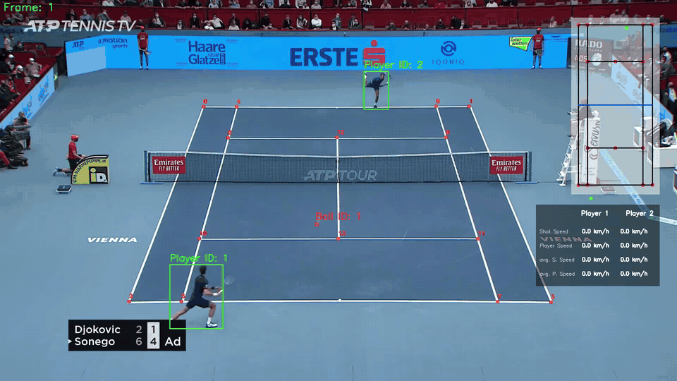
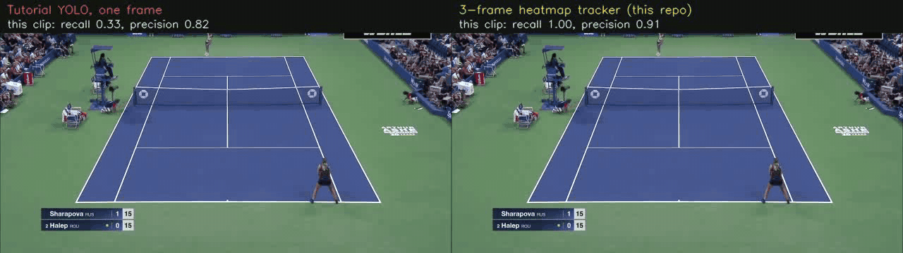

# Tennis Match Analysis

Computer vision pipeline that tracks the players and the ball in broadcast tennis video, finds hits and bounces, and turns them into shot speeds, line calls, rallies and heatmaps.

This project started from [abdullahtarek/tennis_analysis](https://github.com/abdullahtarek/tennis_analysis), a YouTube tutorial: YOLOv8 for players, a fine-tuned YOLO for the ball, a ResNet50 that regresses 14 court keypoints, and a mini court scaled by player height. That pipeline had never been measured. This repo measures it against labelled data, fixes what the numbers showed was broken, and replaces the weakest parts. The goal and the definition of done are in [SPEC.md](SPEC.md).

## Demo

The full pipeline on the tutorial's clip: court keypoints, player boxes, the ball, shot speeds and the mini court.



The ball on a match neither model trained on (TrackNet game 9, clip 2). The white ring is the labelled ball. Left: the tutorial's single-frame YOLO detector. Right: this repo's 3-frame tracker. Each panel header carries that clip's recall and precision.



<!-- results:start -->
## Results

Every number below is read from `results/*.json` by `python -m evaluation.report`.

| Ball detector (TrackNet games 9-10, 3,717 frames) | Precision | Recall | F1 | Median error |
| --- | --- | --- | --- | --- |
| Tutorial YOLO, last box kept (as shipped) | 0.785 | 0.315 | 0.449 | 1.91 px |
| Tutorial YOLO, most confident box | 0.802 | 0.319 | 0.457 | 1.91 px |
| 3-frame heatmap tracker (this repo) | 0.853 | 0.985 | 0.914 | 2.05 px |

| Hit / bounce detection (+-5 frames) | Hits F1, games 9-10 | Bounces F1, games 9-10 | Hits / bounces F1, games 1-8 out-of-fold |
| --- | --- | --- | --- |
| Tutorial shot detector on YOLO positions | 0.626 | not detected | - |
| Tutorial shot detector on tracker positions | 0.571 | not detected | - |
| Event MLP v1 (image y feature, thresholds from game 8) | 0.670 | 0.686 | - |
| Event MLP v2 (no image y, mirrored, leave-one-game-out thresholds) | 0.637 | 0.692 | 0.864 / 0.912 |
| Event MLP v2 on ground-truth trajectories (upper bound) | 0.889 | 0.926 | 0.884 / 0.930 |

| Court keypoints (TennisCourtDetector val, 7 px rule) | Precision | Accuracy | Median error |
| --- | --- | --- | --- |
| Tutorial ResNet50 regression | 0.829 | 0.828 | 3.82 px |
| Tutorial ResNet50 + RANSAC homography | 0.829 | 0.829 | 3.78 px |
| Heatmap U-Net (this repo) | 0.991 | 0.991 | 1.44 px |
| Heatmap U-Net + RANSAC homography | 0.993 | 0.993 | 1.37 px |
| Published, TennisCourtDetector base model (cited from its README) | 0.936 | 0.933 | 2.83 px |
| Published, TennisCourtDetector + refinement + homography (cited) | 0.963 | 0.961 | 1.83 px |

| End-to-end pipeline (NVIDIA GeForce RTX 3090) | Frames | Wall time | Frames/s | Peak RAM (GiB) |
| --- | --- | --- | --- | --- |
| Old pipeline (whole video in RAM, YOLO ball), input_video.mp4 | 214 | 20.8 s | 10.3 | 4.32 |
| This pipeline, tutorial YOLO ball, heatmap court, input_video.mp4 | 214 | 19.9 s | 10.7 | 2.14 |
| This pipeline, heatmap ball + heatmap court + homography, input_video.mp4 | 214 | 19.2 s | 11.1 | 2.11 |
| Old pipeline (whole video in RAM, YOLO ball), input_x5.mp4 | 1070 | crashed | - | >= 8.29 at the crash |
| This pipeline, tutorial YOLO ball, heatmap court, input_x5.mp4 | 1070 | crashed | - | >= 2.18 at the crash |
| This pipeline, heatmap ball + heatmap court + homography, input_x5.mp4 | 1070 | 78.4 s | 13.7 | 2.16 |

Leakage check: 0 of the 578 images the tutorial's ball detector trained on match any TrackNet frame (64-bit dHash, <= 6 bits).
<!-- results:end -->

## What changed from the tutorial

- **Benchmarks first.** `evaluation/` scores the ball detector on the [TrackNet](https://arxiv.org/abs/1907.03698) dataset (10 broadcast matches, split by match so no match is in both train and test) and the court model on the [TennisCourtDetector](https://github.com/yastrebksv/TennisCourtDetector) val split, with the same rules those repos use, so the numbers compare. TrackNet labels some hits and bounces on two or three consecutive frames (5 of the 93 hit labels in matches 9-10); the loader counts each run once, so no detector is charged a miss it cannot avoid.
- **Ball tracker.** A TrackNetV2-style U-Net (`ball_tracking/`) sees three consecutive frames and outputs a heatmap. A tennis ball is a few blurred pixels; one frame often cannot separate it from a shoe or a line, three frames show its motion. Trained here on matches 1-7, checkpoint and decode threshold chosen on match 8, scored once on matches 9-10.
- **Bug: the ball detector kept its least confident box.** The tutorial's loop overwrote the ball for every box, and YOLO returns boxes sorted by confidence, so the last (weakest) one won. Fixed in `trackers/ball_tracker.py`.
- **Bug: the whole video lived in RAM.** A 1080p frame is 6.2 MB, so a 10-minute match at 30 fps is 112 GB. Frames are now streamed in two passes (detect, then draw), one frame in memory at a time.
- **Bug: missing dependency.** ByteTrack needs `lap`, which was not declared, so a clean install crashed on the first frame.
- **Geometry from ground contacts only.** The tutorial projected every ball position onto the court with one metres-per-pixel scale from a player's height. A broadcast view foreshortens depth, so one scale cannot fit both axes, and a ball in the air is not above its court position. Now a RANSAC homography maps the 14 keypoints onto the real court in metres (`court_lines/homography.py`), and only feet and bounces are projected. Shot speed is the hitter's feet to the bounce over the elapsed time; each bounce gets an in/out call (`analytics/shots.py`).
- **Hits and bounces.** A small MLP reads the trajectory around each frame and scores flying / hit / bounce (`ball_tracking/events.py`). Real hits sit at least 11 frames apart in the labels, so a second hit within 10 frames of a stronger one is suppressed; that window is chosen with the threshold on held-out matches, never on test. The tutorial's detector found some hits and no bounces.
- **Court keypoints as heatmaps.** The tutorial's ResNet50 squeezes the frame to 224x224 and regresses 28 numbers, so one output unit is 5.7 px wide at 1280x720. The same U-Net as the ball tracker (one frame in, one heatmap per keypoint out, 640x360) localises each point on its own grid (`court_lines/heatmap.py`), and the 14 points are snapped onto one court through the RANSAC homography (`court_lines/heatmap_detect.py`).

## Reproduce

```bash
uv sync --extra dev

# Ball tracker: shrink frames once, train, predict, score
python -m ball_tracking.prep --data <tracknet>/Dataset --out <tracknet_512>
python -m ball_tracking.train --data <tracknet_512> --shrunk --out runs/tracknet --epochs 25
python -m ball_tracking.predict --data <tracknet>/Dataset --ckpt runs/tracknet/best.pt --thr 0.9 --out preds.json
python -m evaluation.ball --data <tracknet>/Dataset --preds preds.json --out results/ball_tracknet.json
python -m evaluation.demo_ball --data <tracknet>/Dataset --preds preds.json --clip game9/Clip2 --out output_videos/ball_compare.gif

# Tutorial baseline on the same frames, and the leakage check
python -m evaluation.ball --data <tracknet>/Dataset --weights models/last.pt --out results/baseline_ball.json
python -m evaluation.leakage --images training/tennis-ball-detection-6 --data <tracknet>/Dataset

# Hits and bounces
python -m ball_tracking.events --data <tracknet>/Dataset --preds preds.json --cv --out results/events_v2.json

# Court keypoints: tutorial baseline, then the heatmap model (trained on 90% of the
# train split, checkpoint picked on the other 10%, scored once on val)
python -m evaluation.court --data <court dataset>/data --out results/court_baseline.json
python -m court_lines.prep --zip court_dataset.zip --out <court_640>
python -m court_lines.heatmap --data <court_640> --out runs/court --epochs 20
python -m evaluation.court --data <court dataset>/data --heatmap runs/court/best.pt --out results/court_heatmap.json

# End-to-end wall time and peak RAM (Linux, GNU time)
ffmpeg -f concat -safe 0 -i input_videos/x5.txt -c copy input_videos/input_x5.mp4  # the clip 5 times, 4 hard cuts
python -m evaluation.pipeline_bench --old-dir <tutorial-era checkout> --videos input_videos/input_video.mp4 input_videos/input_x5.mp4

# Rebuild the results block above
python -m evaluation.report
```

Datasets: TrackNet ([download](https://drive.google.com/drive/folders/11r0RUaQHX7I3ANkaYG4jOxXK1OYo01Ut)), TennisCourtDetector ([download](https://drive.google.com/file/d/1lhAaeQCmk2y440PmagA0KmIVBIysVMwu)).

## Installation

```bash
git clone https://github.com/samitmohan/tennis-analysis.git
cd tennis-analysis
uv sync --extra dev
```

### Model weights

The trained weights are on the [weights-v1 release](https://github.com/samitmohan/tennis-analysis/releases/tag/weights-v1):

```bash
for f in tracknet.pt court_heatmap.pt events.pt; do
  curl -L --create-dirs -o models/$f https://github.com/samitmohan/tennis-analysis/releases/download/weights-v1/$f
done
```

| Model | File | Purpose |
|-------|------|---------|
| YOLOv8x | downloaded automatically | Player detection |
| Ball tracker | [`models/tracknet.pt`](https://github.com/samitmohan/tennis-analysis/releases/download/weights-v1/tracknet.pt) | 3-frame heatmap tracker, `ball_tracking.train` |
| Event model | [`models/events.pt`](https://github.com/samitmohan/tennis-analysis/releases/download/weights-v1/events.pt) | Hits and bounces, `ball_tracking.events` |
| Court keypoints | [`models/court_heatmap.pt`](https://github.com/samitmohan/tennis-analysis/releases/download/weights-v1/court_heatmap.pt) | 14-heatmap U-Net, `court_lines.heatmap` |
| Tutorial court model | `models/keypointsModel.pth` | Only with `court_model: "resnet"` |
| Tutorial ball detector | `models/last.pt` | Only with `ball_tracker: "yolo"` |

## Usage

```bash
# Annotated video
tennis-analyze -i input_videos/input_video.mp4 -o output/

# Statistics only (shots with speed, bounce position and in/out call)
tennis-analyze -i input_videos/input_video.mp4 --export-stats stats.json --no-video

# Player heatmaps
tennis-analyze -i input_videos/input_video.mp4 -o output/ --heatmap
```

### Configuration

`config/default.yaml`:

```yaml
models:
  player_detector: "yolov8x"
  ball_tracker: "tracknet"   # "yolo" runs the tutorial's single-frame detector and geometry
  tracknet: "models/tracknet.pt"
  events: "models/events.pt"
  court_model: "heatmap"     # "resnet" runs the tutorial's keypoint regressor
  court_heatmap: "models/court_heatmap.pt"

rally:
  gap_threshold_seconds: 3.0
```

With `ball_tracker: "yolo"`, or when the event model or a court homography is missing, the pipeline falls back to the tutorial's geometry and logs a warning.

## How it works

1. **Players.** YOLOv8x with ByteTrack; the two people nearest the court keypoints are kept.
2. **Ball.** The heatmap tracker runs over a sliding 3-frame window; the blob around the heatmap peak gives the position.
3. **Court.** The heatmap model finds 14 points on the first frame; RANSAC fits a homography from the court, in metres, to the image, and the points are replaced by the court projected through it.
4. **Events.** The event MLP scores each frame from the ball's motion within +-7 frames (233 ms) and keeps peaks at least 5 frames apart.
5. **Shots.** Each hit pairs with the first bounce before the next hit. Speed = distance from the hitter's feet to the bounce, over time. The bounce point gives the in/out call against the singles court.
6. **Rallies and heatmaps.** Unchanged from the tutorial: shots more than 3 s apart start a new rally.

## Project structure

```
tennis-analysis/
  cli.py, pipeline.py, config.py
  ball_tracking/       # heatmap tracker: model, data, prep, train, predict, events
  court_lines/         # keypoint model, homography, heatmap keypoint trainer, data prep
  evaluation/          # metrics, TrackNet loader, ball / court / leakage benchmarks, report, demo GIF
  trackers/            # player tracker, YOLO ball tracker, TrackNet ball tracker
  analytics/           # shots (speed, line calls), rallies, export, heatmaps
  mini_court/, utils/, constants/
  results/             # benchmark outputs; the README table is built from these
  tests/
```

## Tests

```bash
uv run --extra dev pytest
```

The tests check the benchmark rules case by case, the homography (exact round trips, RANSAC outvoting a bad keypoint), shot speed through a known homography, the flip permutation for court augmentation, that streaming inference matches clip inference, that an event labelled on consecutive frames counts once, and that player stats count the last shot and leave a hit without a bounce out of the speed average.

## Limitations

- **Hits and bounces on unseen broadcasts.** The event model scores well out-of-fold on matches 1-8 and drops on test matches 9-10 (event table). Fed ground-truth trajectories, the same model recovers most of the drop on matches 9-10 (last row), so the gap comes from the tracker's false positives on those broadcasts, not from the event model. On test hits the event model is level with the tutorial's shot detector; its gain is bounces, which the tutorial does not detect. Tracker precision is the next thing to improve. The v2 design was chosen after seeing v1's test numbers; both are reported and v1 now scores higher on test hits. v2 stays the default: its thresholds come from eight held-out matches instead of one, and it does not read the image row, which ties v1 to one camera height.
- **Run-to-run variance.** The event MLP is small and trained on a few hundred events per class; retraining it on another machine or seed moves its test F1 by a few hundredths. Compare rows with that in mind.
- **Serve speed is not validated.** No radar ground truth is included. The speed is an average from hit to bounce, which reads lower than a radar's peak speed off the racket.
- **Court from the first frame.** A camera cut or zoom invalidates the homography for the rest of the video. Per-scene re-detection is not done yet.
- **Court accuracy is on familiar broadcasts.** The TennisCourtDetector dataset samples train and val frames from the same highlight videos, so its val split (and the published reference numbers) measure courts the model has seen in other frames. A court from a new tournament is untested.
- **In/out calls** use the singles court and do not distinguish serves (service box). They are not scored against labels; no labelled line-call data is used.
- **Two-player singles only**, as in the tutorial.
- **Not real time yet.** End to end the pipeline runs well under the video's 30 fps on an RTX 3090 (pipeline table). The heatmap tracker is not the bottleneck (the YOLO and heatmap rows match); per-frame YOLOv8x player detection and CPU drawing and encoding are the suspects, and need per-stage profiling before any claim.
- **The tutorial's geometry crashes on cuts.** With `ball_tracker: "yolo"`, `mini_court.py` raises when a chosen player is missing from any frame near the current one (KeyError) or from the current frame (empty `min`). The 5x video in the pipeline table loops, so each loop is a hard cut; the original pipeline and the YOLO fallback both crash there, the default path does not.
